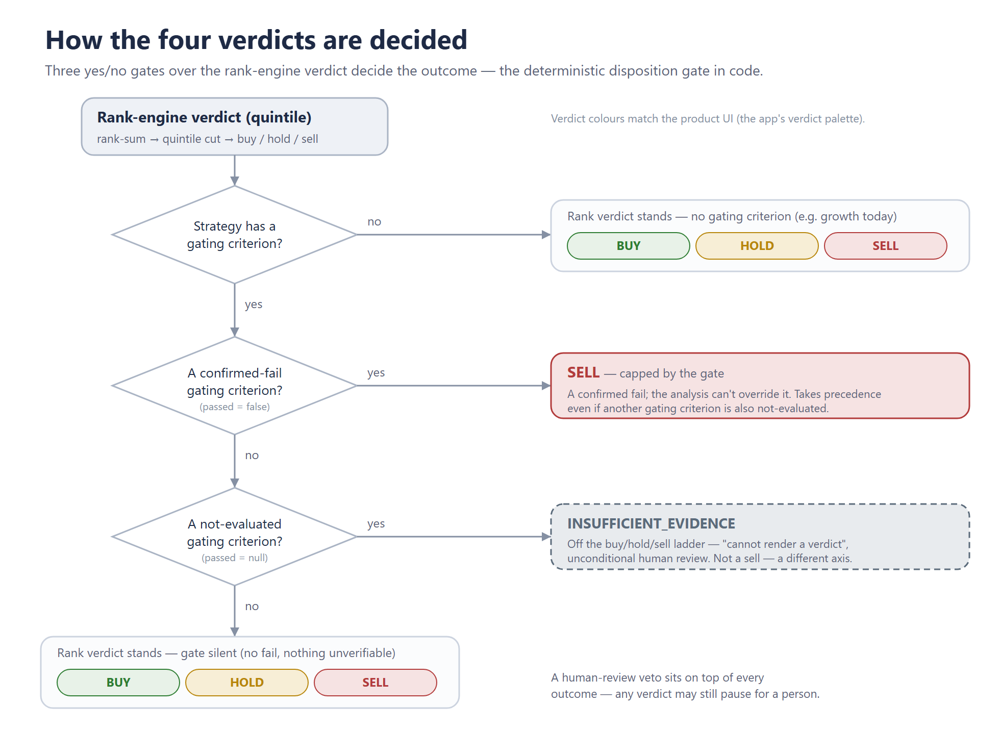

# Aristos Council — How It Works

Aristos Council is an auditable, multi-agent equity research system. Given a ticker and a
strategy, it produces a single recommendation — BUY, HOLD, or SELL, or else
INSUFFICIENT_EVIDENCE (an off-the-ladder state meaning the screen cannot render a verdict,
distinct from any directional call) — with a confidence score and a complete evidence trail:
every number that influenced the verdict is traceable to the exact data source it came from. The design goal is not to predict prices. It is to
apply a stated investment policy consistently, show its work, and refuse to assert anything
it cannot evidence.

This document has three parts. Part A describes how a verdict is reached. Part B points to
[The Calculations](CALCULATIONS.md) — every factor, criterion, and threshold, generated
from the code. Part C describes what the system mechanically guarantees, and how those
guarantees are tested.

---

## Part A — How a Verdict Is Reached

A run moves through five stages. The first three — the ones that decide — are
deterministic code. The language models enter only afterwards, to explain.

**1. The screen.** A rules engine evaluates the ticker against the strategy's absolute
criteria (thresholds live in versioned YAML). Each criterion returns pass, fail, or
not-evaluated. Only a confirmed FAIL excludes; missing data abstains and never silently
disqualifies. A ticker with no usable data at all — a delisted name — is declared
UNRATEABLE: listed with its reason, given no verdict, sent to no model.

**2. The rank.** Names that pass are ranked on the strategy's factors across the whole
universe — rank 1 is best, ties average — and the per-factor ranks are summed. Lowest
combined rank wins. This is the Magic-Formula mechanic: there are no tuned weights to
guess, the ranking is the decision, and every verdict decomposes into named, inspectable
factor ranks. A quintile cut (or top-k for small universes) maps positions to
BUY / HOLD / SELL. The formulas behind every factor are in [The Calculations](CALCULATIONS.md).

**3. The gates.** Two mechanical guards no model can argue past. A confirmed failure on a
*gating* criterion caps the verdict at SELL — the system records when this fired and what
was originally proposed, so code-versus-model disagreement stays visible. A gating
criterion that could not be evaluated yields INSUFFICIENT_EVIDENCE: off the
buy/hold/sell ladder entirely, an unconditional pause for human review rather than a
guessed direction.

**4. The narrative.** Only now do the language models run. Four specialists —
Fundamental, Technical, Sentiment, Risk — write the evidence-bound story of the verdict:
why the name ranked where it did, how it fits the strategy, what a human should check.
Hard rules bound them on every side: every cited figure must carry provenance to the
exact tool output it was read from (a post-run audit re-resolves every citation and
surfaces mismatches rather than correcting them silently); no arithmetic; no outside
knowledge; no reinterpretation of accounting; nothing beyond the evidence asserted as
fact — open questions are phrased as open questions.

The council on a company page is handed the **verdict of record** and nothing else to call "the verdict": the
word that holds a strict majority of the voting lenses, or MIXED when none does, written "HOLD (1 BUY, 4 HOLD,
0 SELL)" (COUNCIL-VERDICT-1). A single lens's BUY is that lens's vote, never "the verdict"; the structural check
flags "the BUY verdict rests on..." over a HOLD record. The same check reads one clause at a time, so a HOLD
said about the voting lenses is not a verdict "given to" Forensic in the same sentence (STRUCT-CHECK-FORENSIC-1),
and it refuses a lens count the data contradicts, and a "no lens split" over differing votes (or "the lenses split" over identical ones): the narrator is handed the sentence counted from the votes, "The lenses split 1 BUY / 4 HOLD" or "The lenses agree: all 5 say HOLD" (SPLIT-WORDING-1) ("the four voting lenses split" over five, FOUR-FIVE-1). The
specialists write stance first, in the first person or with no subject, in the active voice, one figure per
sentence, short paragraphs (SPECIALIST-VOICE-1), and never restate a quarter label from a headline - they say
"the latest quarter" (NEWS-QUARTER-1). The narrator is told to say "peer group", never "cohort" (COHORT-WORD-1), and the
code-written note under the council's tables says "group sizes". Its words are never rewritten, so a stray
"cohort" is caught by the report sweep's banned-word rule, which reads the council section because it sits above
the fold. The AI text check does not count the fixed stance-and-confidence opening, or two specialists restating the
same reported series (free cash flow over its fiscal years), as convergent phrasing (TEXTCHECK-TEMPLATE-1).

Why don't the models judge? Because we measured what happened when they did. The council
originally held the verdict and flipped on identical inputs. Moved to a second-opinion
role, it disagreed with 100% of verdicts in a pre-registered controlled experiment across
three strategies — and when its best objection (momentum) was handled deterministically,
it began objecting to momentum itself. Its valid insights were hardened into rules: the
momentum objections became a momentum factor; its one legitimate catch (a name ranking
well while failing the strategy's own quality floor) became the screen-as-prefilter. The
engine still contains the `second_opinion` mode, but only for its own tests: it has no UI and
is not meant to be run (the history is in the README's *Why this design* section, and the
forward test of whether model judgement adds anything is the blind judge panel,
`docs/JUDGE_PANEL.md`). The verdict
header states the division of labor plainly: *Verdict: deterministic ranker. Narrative:
LLM (non-judging).*

**5. The veto.** Contested runs escalate to a human: low confidence, material
data-quality gaps, a verdict flip from the prior run on the same name, a gate override of
a confident call, INSUFFICIENT_EVIDENCE always. Benign noise — a single abstention, one
non-gating not-evaluated criterion — is recorded but does not escalate on its own. The
human holds the veto; the system surfaces candidates and shows its work.

---

## Part B — What the Council Measures

The per-strategy detail — every factor, criterion, threshold, and guard — lives in one
generated-from-code reference: **[The Calculations](CALCULATIONS.md)**. Its §2 gives the
factors and their formulas, §3 the dividend-streak counting method (why a *flat* year is
not a cut), §4 the screen criteria with current thresholds, and §5 the guards. Where this
document and the code ever disagree, the code — and The Calculations, which is generated
from it — win.

Ten lenses (rank strategies) are visible on one engine, each pinning its own factors and
floors in a versioned YAML (a published strategy is never edited in place — a new version is
created instead). Seven rank over stocks: **Conservative Formula** (defensive income — low
volatility + net payout +
12-month momentum, screened for covered income, real yield, leverage, and a
momentum-breakdown floor), **value + momentum** (the flagship — Greenblatt's earnings yield +
return on capital with a momentum factor added to demote falling knives; financials excluded),
**Growth at a Reasonable Price** (revenue growth + ROIC + valuation + momentum),
**Greenblatt RAW** (the canonical Magic Formula + momentum with *no screens* — the
exploratory comparison lens), **Financials** (banks/insurers/networks ranked on
price-to-book + return on equity + momentum, the value lenses' sector exclusion inverted),
**Cyclical Income** (income from companies whose profits move with a cycle — oil, mining, shipping —
where "raised the dividend for ten years" is the wrong test, so it asks "has not cut in five"), and
**Forensic**, a *check* lens that does not vote: it ranks companies on whether reported profits are
backed by cash and how far the balance sheet sits from distress, and only *marks* doubts on the
other lenses' picks.
The value strategies pair with an absolute-floor lens screen run as a prefilter — the screen
says who qualifies, the ranking orders survivors; the RAW and Financials lenses rank without
one (quality enters through ranking). The classic Magic Formula, dividend-aristocrat, and
growth (GARP) screens remain available as standalone/legacy configs.
All thresholds are in [The Calculations §4](CALCULATIONS.md#4-screen-criteria-three-state-abstention-never-excludes).

Three lenses rank **ETFs** rather than companies, on fund attributes — **Dividend ETFs**
(distribution yield + expense ratio + fund size + momentum), **Growth ETFs** (expense ratio +
momentum + fund size), and **ETF Index Tracker** (expense ratio + fund size + momentum, with
deliberately *no* yield factor, because core cohorts mix accumulating and distributing share
classes by design). All three are rank-first with no screens and no floors, all three are
exploratory, and a confirmed-only **asset-kind gate** walls the classes apart so a fund can
never leak into a stock lens or the reverse. Their honest limit is stated in each lens's own
config: a fund's real quality is its index methodology and tracking accuracy, and no free
vendor field measures either. Detail: [ETF lenses](../README.md#etf-lenses) and
[The Calculations §2.1](CALCULATIONS.md#21-etf-factors).

### Data sources

The market-data provider is selectable at runtime via `ARISTOS_MARKET_PROVIDER`: **yfinance**
(default), **EODHD**, or a **hybrid** that sources dividend history from EODHD and
fundamentals/prices from yfinance. EODHD is live for dividend history — its deep, clean record
is what makes the 20-year streak verifiable across US and EU names; its fundamentals endpoint
requires EODHD's paid tier, which is exactly why the hybrid exists. Sentiment comes from
**Finnhub** (analyst recommendation trends + company news); without a `FINNHUB_API_KEY` the
Sentiment specialist abstains rather than guess. One source remains designed-but-not-yet-active
— a retrieval layer over **SEC EDGAR** filings to further ground the Fundamental specialist.
The strategy notes above flag exactly where these gaps affect results today.

### What you can change in the app

The app does not edit strategies and has no per-run override controls. A published strategy
file is never mutated: a changed strategy is a new versioned YAML file, so every recorded verdict
stays reproducible against the file it was produced with.

---

## Part C — What's mechanically guaranteed (and how it's tested)

If you are deciding whether to trust this system, the honest answer is that the trust does not
come from the language models. It comes from the deterministic code that surrounds them and from
an automated test suite — over 3,600 tests at last count (3,625 passing, 1 skipped, as of
2026-09-26) — that runs the entire pipeline on every
change with fake models and fake data, no API keys and no network. Each guarantee below is
enforced by that code and re-checked by those tests; none of it depends on a model behaving well
on the day.

**No model makes the call.** The verdict is a pure function of adapter data through the screen,
rank, and gates; no language model output can change it. The LLM layer can only annotate.

**Every figure is traceable.** No language model does arithmetic. Each number is produced by a
pure, deterministic tool and is audited after the fact back to the exact source call it came
from. A number that cannot be resolved to its origin is treated as a hard failure that surfaces
for review, not a footnote that quietly survives.

**The risk discipline cannot be talked around.** The rule that caps the verdict on a confirmed
screen failure is deterministic code, not a prompt: a confirmed failure of a gating criterion
holds the verdict at SELL no matter how bullishly the model argued. This is deliberate —
prompt-level control over the same rule was tried first and proved evadable, so enforcement was
moved into code the model cannot override.

**The system refuses to fake a verdict.** When a gating criterion genuinely cannot be evaluated
— for example, a dividend history too short to confirm the growth streak — the result is
INSUFFICIENT_EVIDENCE, a verdict off the buy/hold/sell ladder that forces unconditional human
review, rather than a false HOLD presented as a real call.

**Human review fires on the things that matter.** Seven deterministic triggers can pause a run
for a human, and the data-quality trigger is severity-aware: a real fetch failure or a screen
that is mostly blind escalates, while a single optional-source gap (such as a missing sentiment
feed) is recorded but does not, on its own, raise the flag — so the flag keeps its meaning
instead of firing on nearly every run.

**Data provenance is honest about its source.** Dividends, fundamentals, and prices are each
attributed to the provider that actually produced them — including the hybrid configuration,
where dividends come from one provider and fundamentals and prices from another — never
collapsed into a single undifferentiated label. The dividend-growth streak is computed by the
counting method matched to each provider's data shape.

**Growth metrics resist cyclical distortion.** Revenue growth is measured as a base-year-robust
trend rather than a naive two-point comparison, and it flags when the two diverge — the warning
sign of a cyclical base year. Return on capital is measured through the cycle (a multi-year
average) rather than off a single peak, and the valuation-to-growth ratio caps an extreme growth
input so a trough-inflated number cannot make a stock look cheap.

**The whole pipeline runs end-to-end in continuous integration**, with fakes standing in for the
models and the data providers, so none of the guarantees above depend on a live key or a network
call — they are re-checked automatically on every change. A dedicated deterministic eval suite
freezes these core guarantees — the disposition gate, the INSUFFICIENT_EVIDENCE short-circuit, and
the human-veto triggers — as fast assertions, so a change that broke one would turn the suite red
before it shipped.

These tests verify the machinery — that figures trace to source, that the gate holds, that the
system abstains rather than guesses. They are a foundation for trust in the process, not a
guarantee that any single verdict is right. Treat its output as rigorous input to your own
judgment.

---

*This explainer describes the system as built. The thresholds, criteria, and decision
mechanics above are read directly from the live strategy configuration and decision code.*
